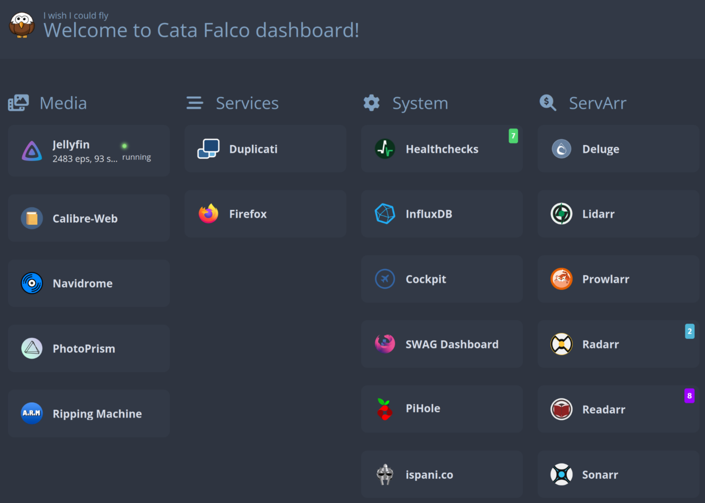

# MANIAC

**MANIAC** — *My Ansible Nifty Infrastructure As Code* — is an Ansible playbook that sets up an Ubuntu-based home media server/NAS with security hardening, NAS features (mergerFS, snapshot/backup solutions), media servers, email notifications, auto-updates, and more.

**Note:** Continuously being developed - don't expect it to work perfectly on the first run.



---

## Quick Reference

| Category | Details |
|----------|---------|
| **Target OS** | Ubuntu (bookworm/bookworm+) |
| **Orchestration** | Ansible 2.19+ |
| **Container Runtime** | Docker with Compose plugin |
| **File Sharing** | Samba server |
| **Networking** | Pi-hole, AdGuard DNS |
| **File Sync** | MergerFS, Rsync, Rclone, Snapraid |
| **Monitoring** | Grafana, InfluxDB, Telegraf, Uptime Kuma |
| **Language Support** | Zsh configuration |
| **Credential Management** | Ansible-vault (encrypted secrets) |

---

## Quick Start: Fresh Install (Ubuntu 22.04+ / Bookworm)

```bash
# Step 1: Install Ansible
sudo apt install ansible -y

# Step 2: Clone repository
git clone https://github.com/elmuz/maniac.git
cd maniac

# Step 3: Copy and customize inventory
cp hosts_example hosts
vi hosts

# Step 4: Create host variables
mkdir -p host_vars/YOUR_HOSTNAME
vi host_vars/YOUR_HOSTNAME/vars.yml

# Step 5: Create encrypted secret variables
ansible-vault create host_vars/YOUR_HOSTNAME/secret.yml
ansible-vault edit host_vars/YOUR_HOSTNAME/secret.yml

# Step 6: Install dependencies
ansible-galaxy install -r requirements.yml

# Step 7: Add your host to the inventory
# Edit hosts file to add your hostname entry

# Step 8: Run the playbook that targets your host
# Playbooks are named after the host or group they target (see "Playbooks" below):
# copy the closest one and set its `hosts:` line to your hostname.
ansible-playbook catafalco.yml -K

# For consecutive runs (only update containers):
ansible-playbook catafalco.yml --tags="port,containers"

# Run specific tag/role:
ansible-playbook catafalco.yml -K --tag docker
```

---

## Adding a Service

1. Add service name to `containers` list in `host_vars/<YOURS>/vars.yml`
2. (Optional) Configure additional variables in `group_vars/all` or host-specific vars
3. Run:
   ```bash
   ansible-playbook catafalco.yml -K --tags containers
   ```

### Reverse-proxy confs (SWAG / nginx)

Every role ships its vhost as `roles/<role>/templates/<name>.subdomain.conf.j2`. The
`proxy_pass` target **must** be built from variables, never written as a literal hostname:

```nginx
location / {
    include /config/nginx/proxy.conf;
    include /config/nginx/resolver.conf;
    set $upstream_app {{ <role>_container_name }};   # never "proxy_pass http://foo:8080;"
    set $upstream_port 8080;
    set $upstream_proto http;
    proxy_pass $upstream_proto://$upstream_app:$upstream_port;
}
```

A literal hostname is resolved when nginx loads its config, so if that container is stopped,
not yet created, or renamed, every reload aborts with
`[emerg] host not found in upstream "foo"` and nginx keeps the old config (or refuses to
start with `SWAG_AUTORELOAD`). A single missing container then breaks *all* sites, not just
its own vhost. With variables the name is resolved per request through Docker's embedded DNS
(`/config/nginx/resolver.conf` → `resolver 127.0.0.11 valid=30s`), so a missing container only
yields 502 for that vhost and heals itself within the resolver TTL.

Caveats of the variable form:

- The URI part of `proxy_pass` is sent verbatim instead of having the matched location prefix
  replaced. To keep a subfolder proxy (`location /office/` → upstream `/`) strip the prefix
  explicitly: `rewrite ^/office/(.*)$ /$1 break;` before the variable `proxy_pass`.
- No `upstream {}` features (keepalive pool, `backup`, balancing) — fine for single containers.
- `proxy_intercept_errors on` (from `roles/swag/files/errors.conf`) replaces the 502 with the
  themed `5xx` page; add `proxy_intercept_errors off;` in locations that must return JSON.

---

## Directory Structure

```
maniac/
├── catafalco.yml           # Main playbook - full media server setup (targets the `catafalco` host)
├── pihole.yml              # Pi-hole focused playbook
├── nilde.yml               # Alternative/simplified configuration
├── ansible.cfg             # Ansible configuration
├── hosts_example           # Example inventory file
├── requirements.yml        # Ansible roles and collections
├── .ansible-lint           # Linting configuration
├── group_vars/             # Group-specific variables
│   ├── all/                # Global variables (timezone, colorscheme, etc.)
│   ├── dns/                # DNS-related configs
│   └── home/               # Home-specific configs
├── host_vars/              # Per-host variables
│   ├── catafalco/          # Main configuration (extensive)
│   ├── nilde/              # Alternative configuration
│   ├── pihole-one/         # Pi-hole node 1
│   └── pihole-two/         # Pi-hole node 2
├── roles/                  # ~64 Ansible roles
│   ├── System & Bootstrap
│   │   ├── system/         # System bootstrapping
│   │   └── zsh/            # Shell configuration
│   ├── NAS & Storage
│   │   ├── mergerfs/       # MergerFS filesystem
│   │   ├── mounts/         # Disk mounts
│   │   ├── hd_idle/        # Hard drive idle timeout
│   │   ├── smartd/         # SMART monitoring: by-id per disk, per-disk temp policy
│   │   ├── snapraid/       # Disk array snapshot tool
│   │   └── vladgh.samba/   # Samba server
│   ├── Docker & Containers
│   │   ├── docker/         # Docker installation
│   │   ├── swag/           # SWAG reverse proxy
│   │   ├── homer/          # Docker dashboard
│   │   ├── watchtower/     # Auto-update containers
│   │   └── socket_proxy/   # Docker socket proxy
│   ├── Media Servers
│   │   ├── jellyfin/       # Media server
│   │   ├── radarr/         # Movies
│   │   ├── sonarr/         # TV shows
│   │   ├── lidarr/         # Music
│   │   ├── lazylibrarian/  # Comics/books
│   │   ├── immich/         # Photo management
│   │   ├── navidrome/      # Music server
│   │   ├── deluge/         # Torrent client
│   │   ├── handbrake/      # Transcoding
│   │   ├── calibreweb/     # E-book management
│   │   ├── arm/            # Automatic ripper
│   │   └── slskd/          # Soulseek client
│   ├── Monitoring
│   │   ├── grafana/        # Dashboarding
│   │   ├── prometheus/     # Metrics collection
│   │   ├── influxdb/       # Time-series DB
│   │   ├── telegraf/       # Collection agent
│   │   ├── mosquitto/      # MQTT broker
│   │   ├── uptime_kuma/    # Uptime monitoring
│   │   └── nmedia_prolcd/  # LCD backup viewer
│   ├── Backup & Sync
│   │   ├── duplicati/      # Encrypted backups
│   │   ├── rclone/         # Cloud file sync
│   │   ├── restic/         # Backup tool
│   │   └── nebula_sync/    # Steam cloud sync
│   ├── Services
│   │   ├── openwebui/      # LLM UI
│   │   ├── vllm/           # LLM inference
│   │   ├── nextcloud/      # Files + Office suite
│   │   ├── vaultwarden/    # Password manager
│   │   ├── actual_budget/  # Personal finance
│   │   ├── invidious/      # Privacy-friendly YouTube
│   │   ├── speedtest/      # Speed tracker
│   │   ├── seafile/        # File sync
│   │   └── miniflux/       # RSS reader
│   └── Utilities
│       ├── hd_idle/        # HDD timeout
│       ├── nvidia/         # GPU support
│       └── cockpith/       # System cockpit
├── tasks/                  # Task files
├── templates/              # Jinja2 templates
├── files/                  # Static files (scripts, icons, etc.)
├── docs/                   # Agent-agnostic knowledge base
│   ├── ansible/            # Ansible expertise, ansible-lint cheatsheet
│   └── monitoring/         # InfluxDB/Grafana deep-dive reference
└── .agents/
    └── skills/             # Cross-agent skills (Agent Skills standard)
```

### Role Structure

Each role follows a consistent structure:
```
<role-name>/
├── defaults/main.yml       # Default variables
├── vars.yml               # Host-specific overrides
├── tasks/                 # Main implementation
├── templates/             # Jinja2 templates
├── handlers/              # Service handlers
└── files/                # Static files
```

---

## Available Media Services

### ServArr (Media Download Managers)

| Role | Container | Purpose |
|------|-----------|---------|
| `radarr` | Radarr | Movies |
| `sonarr` | Sonarr | TV Shows |
| `lidarr` | Lidarr | Music |
| `lazylibrarian` | Lazy Librarian | Comics/Books |
| `prowlarr` | Prowlarr | Indexer manager |
| `deluge` | Deluge | Torrent client |

### Media Servers

| Role | Container | Purpose |
|------|-----------|---------|
| `jellyfin` | Jellyfin | All-in-one media server |
| `immich` | Immich | Photo management |
| `navidrome` | Navidrome | Music server |
| `calibreweb` | Calibre Web | E-book management |
| `handbrake` | Handbrake | Media transcoding |
| `arm` | Automatic Ripper | CD/DVD/Blu-ray ripping |

### DevOps & LLM

| Role | Container | Purpose |
|------|-----------|---------|
| `openwebui` | OpenWebUI | LLM UI |
| `vllm` | vLLM | LLM inference |

### Backup & Sync

| Role | Container | Purpose |
|------|-----------|---------|
| `duplicati` | Duplicati | Encrypted backups |
| `rclone` | Rclone | Cloud file sync |
| `restic` | Restic | Backup tool |
| `nebula_sync` | Nebula Sync | File synchronization |

### Security & Networking

| Role | Container | Purpose |
|------|-----------|---------|
| `authelia` | Authelia | SSO authentication |
| `vaultwarden` | Vaultwarden | Password manager |
| `swag` | SWAG | Reverse proxy + Let's Encrypt |

### Monitoring & Utilities

| Role | Container | Purpose |
|------|-----------|---------|
| `grafana` | Grafana | Dashboarding |
| `influxdb` | InfluxDB | Time-series database |
| `telegraf` | Telegraf | Metrics collection |
| `mosquitto` | Mosquitto | MQTT broker |
| `uptime_kuma` | Uptime Kuma | Uptime monitoring |
| `nmedia_prolcd` | LCD | Backup viewer |
| `wud` | What's Up Docker | Container update notifier |

### Productivity

| Role | Container | Purpose |
|------|-----------|---------|
| `nextcloud` | NextCloud | Files suite |
| `actual_budget` | Actual Budget | Personal finance |
| `invidious` | Invidious | YouTube alternative |
| `speedtest_tracker` | SpeedTest Tracker | Speed test logs |
| `seafile` | Seafile | File sync/sharing |
| `miniflux` | Miniflux | RSS reader |
| `cypht` | Cypht | Webmail |
| `dawarich` | Dawarich | Location history |

---

## Monitoring Stack Architecture

> **Note:** Deep InfluxDB/Grafana knowledge lives in `docs/monitoring/` (`influxdb-grafana-specialist.md` and `grafana-role-best-practices.md`). Consult these when working on dashboards, queries, or monitoring issues, and update them when new troubleshooting techniques or best practices emerge. An `ansible-lint` skill is available in `.agents/skills/`.

### Data Pipeline
```
Telegraf (host service) → InfluxDB v3 Core (Docker container: port 8181) → Grafana (Docker container: port 3000)
                           ↳ Port 8181 (FlightSQL/HTTP API)
```

**Important:** Telegraf is a **host-installed service** (not a container). It sends metrics to InfluxDB via `http://localhost:8181` (NOT the external HTTPS URL through the reverse proxy).

### Telegraf Configuration
- **Config file:** `/etc/telegraf/telegraf.conf` (managed by `roles/telegraf/templates/telegraf.conf.j2`)
- **SMART devices:** generated from `data_disks`, `parity_disks`, `cache_disks` and
  `system_disks` in `host_vars/<host>/vars.yml`. Each entry provides `model`, `serial`
  and `smart_type` (`sat` or `nvme`); **the serial is the disk identity** — there is no
  `device` field, because kernel names are probe-order dependent and change when disks
  are added, moved or the machine is rebooted. At deploy time the role finds the
  matching `/dev/disk/by-id/ata-*` / `nvme-*` link by serial, asserts there is exactly
  one, and hands that path to smartctl (stable across reboots).
  A missing, ambiguous or mistyped serial fails the play with an explicit message
  instead of mislabelling another disk's data.
  SMART polling is `interval = "5m"` with `nocheck = "standby"`, so standby disks are not
  woken.
  **The `device` tag is a static label, not an identity** (`Data1`, `Data2`, `Parity1`,
  `Cache1`, `System`, `NVMe2` — from `label`, or `name` for system disks). A regex
  processor rewrites the by-id tag to that label, so a reboot or a disk shuffle cannot
  retarget it. Never join on `device` / `name`: join on `serial_no` (SMART) or
  `ID_SERIAL_SHORT` (`diskio`). Kernel names are runtime-only (lsblk, `diskio.name`).
  **Every poll also carries a static `serial_no` tag** added by
  `processors.template`, including standby and failed polls where smartctl reports no
  serial. This keeps those rows attributable across a label change. The label is
  display-only; the static serial tag is also display/config data, not a substitute
  for the live serial field.
  Before 2026-10-21 the tag was the kernel name resolved at deploy time, and one reboot
  swapped the two NVMe drives and shifted three SATA disks, so history before the change
  is mixed under a single `device` value — disambiguate it with the serial. The
  reboot/shuffle proof after the fix is recorded as T-12 in the git history (T-06/T-12).
  **The label is a slot/role name, not enumeration** (`NVMe2` = second M.2 slot as wired,
  not `nvme2`). It is bound to the serial, so removing a disk means deleting its
  `host_vars` entry (the roles then fail loudly if the serial is still listed); the
  drive's history stays keyed on `serial_no` and survives (T-10).
- **Disk temperatures are per-serial SMART data.** `[[inputs.temp]]` drops every `nvme_*`
  sensor (`[inputs.temp.tagdrop] sensor = ["nvme_*"]`) because the `temp` measurement has
  no disk identity and the two NVMe drives collided on `sensor=Composite`. Use
  `smart_device.temp_c` (composite) or `smart_attribute` `Temperature_Celsius` /
  `Temperature_Sensor_N` (per serial) instead. CPU/motherboard sensors (`coretemp_*`,
  `acpitz`) stay in `temp`. See the `inputs.temp` comment in
  `roles/telegraf/templates/telegraf.conf.j2` (T-09).
- **Disk I/O tags:** `[[inputs.diskio]]` keeps the kernel-name `name` tag (existing
  panels key on it) and adds `device_tags = ["ID_SERIAL_SHORT", "ID_MODEL"]`, so I/O
  metrics can be joined to SMART on the serial instead of on `sda`/`nvme0`. Note the
  diskio tag is `name`, not `device`; the SMART measurements use `device`.
- **Environment variables:** `/etc/default/telegraf` (managed by `roles/telegraf/templates/telegraf.j2`)
- **Key environment variable:** `INFLUX_URL="http://localhost:8181"` — must use local HTTP, NOT external HTTPS
- **Network interfaces monitored:** `eth*`, `enp*`, `eno*`, `lo` (configured in telegraf.conf `[[inputs.net]]` section)
- **Collected inputs:** cpu, disk, diskio, docker, intel_powerstat, mem, mqtt_consumer, net, nvidia_smi, processes, smart, swap, system, temp, upsd

### InfluxDB v3 Core
- **Container:** `influxdb` (image: `influxdb:3-core`, overridable via `influxdb_image`)
- **API port:** 8181 (FlightSQL/HTTP)
- **Database:** `system-monitor`
- **Query language:** SQL only (NOT InfluxQL)
- **Query file limit:** raise it with `INFLUXDB3_QUERY_FILE_LIMIT` (the role sets 2000) and always include time range constraints in queries
- **Persistence:** the container mounts `<docker_dir>/influxdb/db` at `/var/lib/influxdb3`,
  i.e. the store **root**, not the data dir. That is deliberate: everything InfluxDB writes
  (`catalog`, `wal`, `dbs`, object-store files) lives below that root, so the store is on the
  bind mount whether the data-dir variable is honoured, falls back to a default, or a future
  image renames it again. The variable the image reads today is `INFLUXDB3_DATA_DIR`
  (`--data-dir`); the role used `INFLUXDB3_DB_DIR`, which a 2026-07 image upgrade started
  ignoring, so the store silently moved to a path inside the container's writable layer and
  every recreate deleted it (2026-07-31 → 2026-10-21, T-21).
  The role therefore asserts that `/srv/influxdb/db` is mounted at `/var/lib/influxdb3` **and**
  that files appear under it after the container starts; both fail the play with the
  diagnostic commands instead of losing history. `/srv/influxdb/data` is the pre-fix
  store (archive, last written 2026-07-31) and is not used by the running container.
- **Image pinning:** `3-core` is a floating tag pulled on every run (and watchtower updates
  containers), so pin `influxdb_image` for reproducible upgrades. The role records the deployed
  binary's `data-dir` CLI contract on every run — when the store path moves again, that output
  says what the version actually expects.
- **Deploy:** `ansible-playbook catafalco.yml -K --tags influxdb`. A change to the volume list or
  to the data-dir env recreates the container; a fresh store starts at that point. The role
  prints the deployed binary's `--data-dir` line, so check it whenever the image tag changes.
- **Retention:** `influxdb_retention_period` (default `90d`) is applied when the database is
  created (`influxdb3 create database --retention-period`). InfluxDB 3 Core **cannot change**
  the retention of an existing database — `influxdb3 update database` does not support it — so
  the role fails if the database reports infinite retention while a finite window is configured,
  and the only fix is recreating the database (which deletes its data). Retention is also the
  disk bound: expired data is dropped, so the store cannot grow past the window. The check
  matches "none/infinite/never/forever" rather than the exact duration string, because the CLI
  renders periods its own way.
- **Ingest measured (2026-10-22):** ~12 800 rows / 10 min (~1.85 M rows/day), of which
  `docker_container_*` is ~75 %. Raw WAL is ~150 KB per 10 s (~1.3 GB/day) but WAL files are
  deleted once compacted to parquet, so WAL size is not the disk cost; ask
  `SELECT count(*), sum(size_bytes), sum(row_count) FROM system.parquet_files` for the durable
  size. Levers if the store grows too fast: `[[inputs.docker]] interval` (10 s → 60 s cuts ~62 %
  of all rows) or a shorter `influxdb_retention_period`.

### Grafana Panel & Field Gotchas
- **Known Telegraf field names** (verify before querying): `temp` measurement uses field `temp` (NOT `temp_c`); `nvidia_smi` uses `temperature_gpu`; `smart_attribute` uses `raw_value` for `Temperature_Celsius` (NOT `value`). Full reference: `docs/monitoring/influxdb-grafana-specialist.md`
- **Legend labels** show `field_name tag_value`; strip the prefix with a `renameByRegex` transformation (`"regex": ".*\\s+(.*)"`, `"renamePattern": "$1"`)
- **`spanNulls: false`** for panels where gaps carry meaning (idle disks), `spanNulls: true` for continuous metrics
- **Sensor notes:** `acpitz` (ACPI thermal zone) often reports stale/constant values — not a bug. NVMe temperatures are not in `temp` any more (T-09); use the per-serial SMART `Temperature_Celsius` / `Temperature_Sensor_N` rows

### Grafana Dashboards
- **Container:** `grafana` (image: `grafana/grafana:latest`)
- **Datasources:** InfluxDB_v3_SQL (default, uid: `PA6F3E0496B9A4E62`)
- **Dashboard template:** `roles/grafana/templates/provisioning.dashboards.system.json.j2`
- **Provisioned dashboards:** System Monitor, Docker Containers, S.M.A.R.T. Disk Health, Temperature Monitor

### Grafana + InfluxDB v3 SQL Rules
1. **Use SQL syntax, NOT InfluxQL** — no `SELECT time, "field" FROM "measurement"`, use `SELECT time, field FROM measurement`
2. **No double quotes** around table names or field names in SQL queries
3. **All time_series queries MUST have `ORDER BY time`** — Grafana requires ascending time order
4. **Variable definitions need time constraints** — use `WHERE time > now() - INTERVAL 24 HOUR` to avoid InfluxDB v3 file scan limit
5. **Multi-value variables** — use `${variable:sqlstring}` format for proper SQL quoting (e.g., `interface IN (${interface:sqlstring})`)
6. **No window functions via FlightSQL** — `LAG()`, `LEAD()`, etc. may not work through Grafana's Flight SQL connector. Use Grafana's built-in transformations (`calculateField` with `mode: "rate"`) instead
7. **Time bucketing** — Grafana handles time grouping automatically when `format` is `"time_series"`. Do NOT use `GROUP BY time($__interval)`
8. **Series separation** — include the tag column in SELECT (e.g., `SELECT time, container_name, usage_percent`) for Grafana to create separate lines per tag value
9. **Dashboard default time range:** Last 30 minutes (`"from": "now-30m"`)

### Troubleshooting Grafana/InfluxDB
- Check Telegraf logs: Use MCP `mcp__remote-server__get_service_logs(service="telegraf")`
- Common error: `context deadline exceeded` — Telegraf can't reach InfluxDB (usually wrong URL)
- Common error: `invalid function 'time'` — Using InfluxQL `GROUP BY time()` instead of SQL
- Common error: `not sorted in ascending order by time` — Missing `ORDER BY time` in time_series query
- Common error: `No field named XXX` — Field name mismatch between dashboard query and actual InfluxDB schema
- Common error: **HTTP 500 from InfluxDB** — usually the 432-file scan limit (missing/insufficient time range), not a server error. Add or tighten `WHERE time > now() - INTERVAL X HOUR`
- Common error: **HTTP 500 whose body is the themed `catafal.co` "Service Unavailable" HTML page** — SWAG's `errors.conf` sets `proxy_intercept_errors on` and was replacing InfluxDB's JSON error. The InfluxDB and Prometheus API locations override it with `proxy_intercept_errors off`; if the HTML comes back, that override is missing from the deployed `influxdb.subdomain.conf` (redeploy the `influxdb` role and restart SWAG). The MCP clients report this as `InfluxDB query failed (HTTP 500)` plus the HTML, which hides the real SQL error.
- Check InfluxDB data: Use MCP `mcp__remote-server__get_service_logs(service="influxdb")` and search for query results
- Grafana query logs: Use MCP `mcp__remote-server__get_service_logs(service="grafana")` and search for 'influx_flightsql'

### Deploy Commands
```bash
# Deploy Grafana changes
ansible-playbook catafalco.yml --tags grafana --vault-id iac@.vaults

# Restart Grafana container (mandatory after provisioning changes!)
mcp__remote-server__restart_service(service="grafana")

# Deploy Telegraf changes
ansible-playbook catafalco.yml --tags containers  # Telegraf is host-installed, not a container
```

### Remote Server Management via MCP

**IMPORTANT:** All remote server management should be done via the MCP "remote-server" tool. **DO NOT use SSH commands** to interact with the remote server. The MCP tool provides a secure proxy interface for all remote operations.

#### Available MCP Remote-Server Tools

| Tool | Purpose |
|------|---------|
| `mcp__remote-server__get_server_health` | Get overall server health (CPU, memory, disk) |
| `mcp__remote-server__list_services` | List all services in /srv/ directory |
| `mcp__remote-server__get_service_status` | Get detailed status of a specific service |
| `mcp__remote-server__get_service_logs` | Get logs for a specific service |
| `mcp__remote-server__search_service_logs` | Search service logs for a specific pattern |
| `mcp__remote-server__restart_service` | Restart a service (Docker container) |
| `mcp__remote-server__start_service` | Start a stopped service |
| `mcp__remote-server__stop_service` | Stop a running service |
| `mcp__remote-server__get_service_file` | Get contents of a file within a service directory |
| `mcp__remote-server__list_service_files` | List files in a service directory |

#### Disk Health MCP Tools (disk/SMART diagnostics)

| Tool | Purpose |
|------|---------|
| `mcp__disk-health__list_disks` | List all storage devices |
| `mcp__disk-health__get_disk_health` | Get health report for a specific disk |
| `mcp__disk-health__get_smart_attributes` | Get raw SMART attributes |
| `mcp__disk-health__get_nvme_health` | Get NVMe SMART health log |
| `mcp__disk-health__get_io_stats` | Get disk I/O statistics |
| `mcp__disk-health__get_raid_status` | Get mdadm RAID status |
| `mcp__disk-health__get_zfs_status` | Get ZFS pool status |
| `mcp__disk-health__get_full_disk_report` | Comprehensive disk health overview |
| `mcp__disk-health__query_influxdb_disk` | Query InfluxDB for historical disk metrics |

**For disk-related tasks, prefer disk-health MCP tools over manual InfluxDB queries** — they handle data source fallbacks (InfluxDB → direct smartctl) and provide formatted reports.

#### Host prerequisites for the MCP tools

These are set up by this playbook and matter when a tool silently returns nothing:

- **Journal access:** `username` is added to `systemd-journal` by the `telegraf` role. Without
  it, `get_host_service_logs` returns "No entries" (journalctl exits 0 with a permission
  hint on stderr). Open sessions keep their old groups, so the MCP server must reconnect.
- **`iostat`:** `sysstat` is installed by the `telegraf` role; `get_io_stats` reports
  `command not found` without it. `mdadm`/`zpool` are not installed on this SnapRAID host,
  so `get_raid_status`/`get_zfs_status` are expected to report missing commands.
- **SnapRAID status:** `snapraid status` must run as root. SnapRAID creates the content
  file and its `<content>.lock` as `root:root 0600` (`state.c` writes a 0600
  `<content>.tmp` and renames it into place; `util.c` opens the lock with `0600` and never
  deletes it). ACLs do not fix this: the `0600` mode masks inherited default-ACL entries
  to `---`, and the content inode is replaced on every sync. The `snapraid` role therefore
  installs `/etc/sudoers.d/snapraid-status`, which allows `username` to run exactly
  `/usr/local/bin/snapraid status` without a password, and the disk-health MCP runs
  `sudo -n /usr/local/bin/snapraid status` (its command policy accepts only that literal
  and keeps `sudo` blocked everywhere else). Since 2026-10-20 the blanket
  `ALL=(ALL) NOPASSWD: ALL` grant has been removed on purpose (T-02), so scoped entries like
  this one are load-bearing:
  `snapraid status` works, nothing else does. The MCP-side command restriction is what bounds
  what can actually run. A leftover lock is normal — SnapRAID only `flock`s it; delete it only
  after a killed run and only when no snapraid process runs.
- **No blanket passwordless sudo since 2026-10-20.** `%sudo ALL=(ALL) NOPASSWD: ALL` was
  removed deliberately so tooling has to use scoped privileges. The repo now removes both
  legacy `NOPASSWD` lines during provisioning (`roles/system/tasks/user.yml`), and
  `host_vars/catafalco/vars.yml` sets `security_sudoers_passwordless: []` with a passworded
  admin entry. Automation gets narrow `/etc/sudoers.d/` grants instead:
  `telegraf-smart` (`/usr/sbin/smartctl`, `/usr/sbin/nvme`) and `snapraid-status`
  (`snapraid status`). Host-verified 2026-10-20 23:35 CEST: `sudo -n true` fails, telegraf
  is only in `docker`, SMART polls succeed, and the SSH-backed MCP tools recovered (the
  earlier "connection closed" errors were a stale pooled connection, not a permanent sudo
  dependency). The T-04 command-template audit remains (T-02/T-03/T-04 and Appendix D, git
  history).
- **Ansible-managed containers:** roles that use `community.docker.docker_container` (for
  example `invidious-db`, `speedtest_tracker-db`, `socket-proxy`) have no compose project
  label and often no `/srv/<name>` directory. They must be listed in
  `security.allowed_containers` in the remote-server MCP config, otherwise every tool
  rejects them and `list_containers` shows their service as `-`.

#### Common Remote Operations (Use MCP, NOT SSH)

```bash
# ❌ DO NOT use: ssh catafalco "sudo systemctl restart telegraf"
# ✅ USE MCP instead: mcp__remote-server__restart_service(service="telegraf")

# ❌ DO NOT use: ssh catafalco "docker restart grafana"
# ✅ USE MCP instead: mcp__remote-server__restart_service(service="grafana")

# ❌ DO NOT use: ssh catafalco "docker logs grafana"
# ✅ USE MCP instead: mcp__remote-server__get_service_logs(service="grafana", lines=100)

# ❌ DO NOT use: ssh catafalco "docker ps"
# ✅ USE MCP instead: mcp__remote-server__list_services()

# ❌ DO NOT use: ssh catafalco "journalctl -u telegraf -f"
# ✅ USE MCP instead: mcp__remote-server__get_service_logs(service="telegraf", lines=100)
```

#### Troubleshooting via MCP

```bash
# Check service health
mcp__remote-server__get_service_status(service="grafana")

# View service logs
mcp__remote-server__get_service_logs(service="influxdb", lines=200)

# Search logs for errors
mcp__remote-server__search_service_logs(service="telegraf", pattern="error", lines=500)

# Check server health
mcp__remote-server__get_server_health()

# Restart a service
mcp__remote-server__restart_service(service="grafana")
```

---

## Key Configuration Files

### Host Variables (`host_vars/<hostname>/vars.yml`)

| Setting | Description |
|---------|-------------|
| `hostname` | Hostname (usually inventory_hostname) |
| `lan_network` | Local network (e.g., `192.168.178.0/24`) |
| `username` | Non-root admin user |
| `shell` | Default shell (usually `/usr/bin/zsh`) |
| `nord_colors` | GUI colorscheme |
| `containers` | List of Docker services to deploy |
| `enable_containers` | Enable/disable containers |
| `enable_nas_stuff` | Enable NAS features (mergerFS, Samba, etc.) |
| `enable_samba` | Enable Samba file sharing |
| `mergerfs_root` | Root directory for MergerFS |
| `email` | For email notifications (SMTP) |
| `version` | Ubuntu version (e.g., `bookworm`) |

### Secret File (`host_vars/<hostname>/secret.yml`)

| Setting | Description |
|---------|-------------|
| `healthchecks_dashboard_url` | HealthChecks dashboard URL |
| `email_password` | E-mail password (for alerts) |
| `tasmota_mqtt_password` | MQTT password for Tasmota devices |
| `telegraf_mqtt_password` | MQTT password for Telegraf device |
| `docker_password` | Docker socket password |
| `julia` | SMB server address |
| `julia_samba_username` | Samba username for Julia SMB server |
| `julia_samba_password` | Samba password for Julia SMB server |

---

## Docker Address Pools

```yaml
docker_address_pools:
  - base: "172.32.0.0/16" # 256 networks of 256-2=254 peers
    size: 24
  - base: "172.33.0.0/16"
    size: 24
```

---

## Common Commands

### Running Specific Roles

```bash
# Run just Docker installation
ansible-playbook catafalco.yml -K --tag docker

# Run specific containers
ansible-playbook catafalco.yml -K --tag containers

# Run Samba configuration
ansible-playbook catafalco.yml -K --tag samba

# Dry-run (check mode)
ansible-playbook catafalco.yml --check --list-tags
```

### Tags Available

| Tag | Description |
|-----|-------------|
| `bootstrap` | Initial bootstrap (never run after initial install) |
| `never` | Never run |
| `containers` | Docker containers |
| `zsh` | Shell configuration |
| `msmtp` | Email notifications |
| `nvidia` | NVIDIA GPU support |
| `mergerfs` | Merged filesystems |
| `mounts` | Disk mounts |
| `hd-idle` | Hard drive idle timeout |
| `smartd` | SMART error reporting |
| `samba` | Samba configuration |
| `docker` | Docker engine |
| `grafana` / `monitoring` | Monitoring tools |
| `prometheus` | Prometheus metrics |
| `influxdb` / `mqtt` | Data collection systems |
| `telegraf` | Metrics aggregation |
| `ups` / `nut` | UPS monitoring |
| `servarr` | Media servarr services |
| `backup-sync` | Backup and sync tools |

---

## Playbooks

**Playbooks are named after the host or group they target:** `catafalco.yml` manages the
`catafalco` host, `pihole.yml` the `dns` group, `nilde.yml` the `nilde` host. There is no generic
`site.yml`/`run.yml` entry point — a new machine means copying the closest playbook and changing
its `hosts:` line. References to `catafalco` inside a role are about that machine, not about the
project.

| Playbook | Targets | Description |
|----------|---------|-------------|
| `catafalco.yml` | host `catafalco` | Full media server setup |
| `pihole.yml` | group `dns` | Pi-hole focused setup |
| `nilde.yml` | host `nilde` | Alternative/simplified configuration example |

---

## Examples

### Adding a Container Service

Add to `host_vars/YOUR_HOSTNAME/vars.yml`:

```yaml
containers:
  # ... existing ...
  - your_new_service
```

Then run:
```bash
ansible-playbook catafalco.yml -K --tag containers
```

---

## Development

### Pre-commit Hooks

This project uses pre-commit hooks for linting:

```bash
# Install pre-commit
pip install pre-commit
pre-commit install

# Run manually
pre-commit run --all-files
```

### Ansible Lint

```bash
ansible-lint
```

### Requirements

- Ansible 2.19+
- Python 3.13+
- ansible-core >= 2.19.0

---

## License

DO WHAT THE FUCK YOU WANT TO PUBLIC LICENSE (WTFPL) - See [LICENSE.md](LICENSE.md) for details.

---

## Resources

- [Original inspiration - notthebee/infra](https://github.com/notthebee/infra)
- [Ansible Project](https://www.ansible.com/)
- [Ansible GitHub](https://github.com/ansible)
